<div align="center">

# AxiomForge

**Replicate machine-learning claims with statistics, not with a language model.**

An LLM-agent system that reads a claim, tests it on many real datasets in a sandbox, and lets Python, not the language model, decide the verdict. Its research agent proposes its own follow-up hypotheses and tests them on datasets it never saw.

[](https://github.com/bartuonder/AxiomForge/actions/workflows/ci.yml)
[](LICENSE)


**English** · [Türkçe](README.tr.md) · [Technical report](TECHNICAL_REPORT.md) · [Demo](demo/README.md) · [API](docs/API.md)

<a href="docs/media/axiomforge-demo.mp4">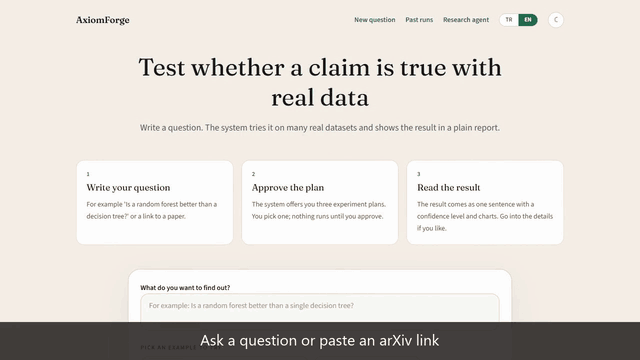</a>

<sub>Silent 70-second walkthrough recorded from the real console. Click for the MP4.</sub>

</div>

---

## Why this exists

Language-model agents can read a paper, write code and write up a result, but they are unreliable judges of evidence. Asked whether a published claim about machine-learning models holds, three things go wrong:

1. **Fluent but unsupported conclusions.** "Model A clearly outperforms B", with no number a reader can check.
2. **No error rates.** Nobody knows how often the system says "yes" when there is no real difference.
3. **Adaptive analysis.** An agent that looks at results and then chooses what to test next tests hypotheses selected by the same data, which inflates false discoveries.

AxiomForge answers the first two with a **replication engine whose verdicts are computed, not written**, and the third with a **research protocol** that keeps confirmation data sealed from the agent that proposes hypotheses.

The language model plans experiments and writes prose. It never decides. Python decides, and every number in a report points to an entry of an evidence ledger.

## Results at a glance

All numbers are produced by tools in this repository and can be reproduced (see the [technical report](TECHNICAL_REPORT.md)).

| Question | Result |
| --- | --- |
| Does it get known claims right? | **10 of 10** well-established comparisons judged as expected on 9 real datasets |
| Does it invent differences? | Decisive verdict in **2.1%** of simulated worlds with no true effect; **0 of 45** testable effects significant when each real model is compared with a copy that differs only in its random seed |
| Does the research agent inflate discoveries? | Family-wise error **3%**, against **24%** for an agent that selects and tests on the same data and 89% for uncorrected testing (16 models, simulation with planted effects) |
| Compared with a language model alone | gpt-4o, asked the same claims without data: 21 of 30 answers right, 0 wrong, 9 abstentions. The system decides all 10 from data and adds the evidence |
| A real research session | 6 models, 16 datasets: **16 hypotheses registered, 15 confirmed, 0 reversed, 1 not confirmed**. The lead of tree ensembles over a neural network was overestimated about 3x on the exploration datasets (the winner's curse) and is reported from the confirmation datasets only |

The honest part: the decision layer is conservative and has low power for differences under one ROC-AUC point with nine datasets, and the real session reproduces a known finding (Grinsztajn et al., NeurIPS 2022); it is not a new scientific result. See [Limits](#limits).

## See it

<table>
<tr>
<td width="50%"><b>Plain-language summary</b><br>Verdict, confidence, per-dataset chart<br>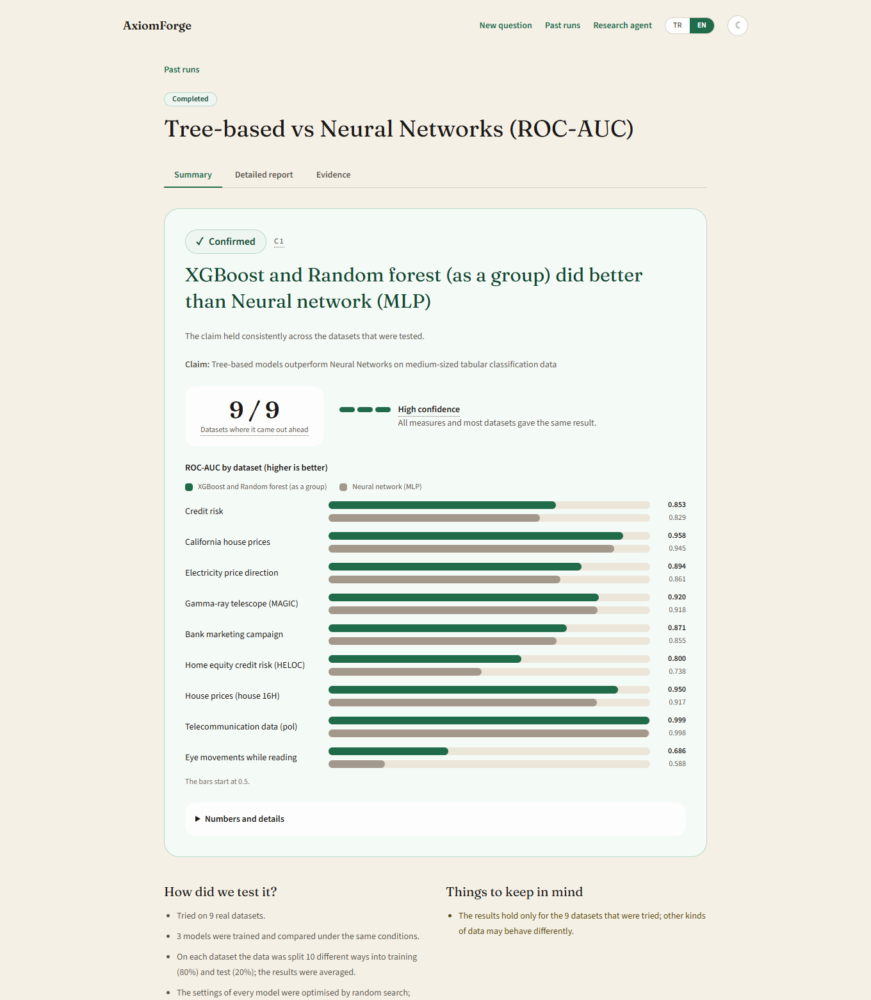</td>
<td width="50%"><b>Same page, dark theme</b><br>Light and dark, English and Turkish<br>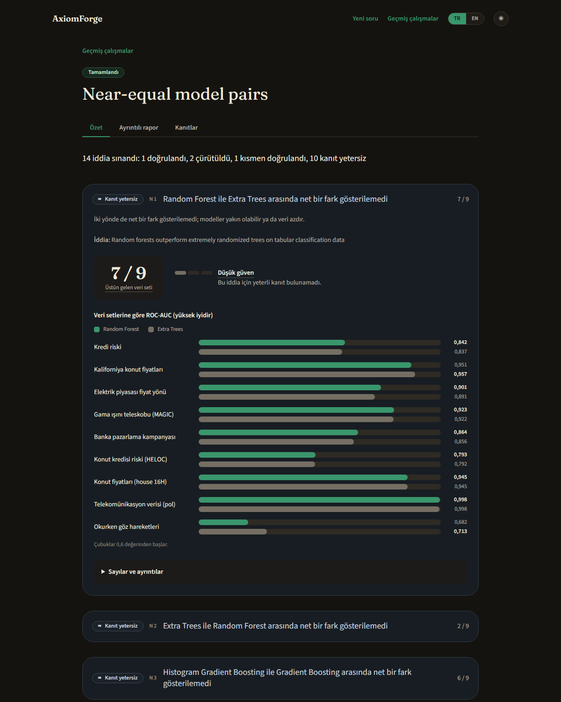</td>
</tr>
<tr>
<td width="50%"><b>Evidence ledger</b><br>Dataset revisions, scores, tests: every number traces here<br>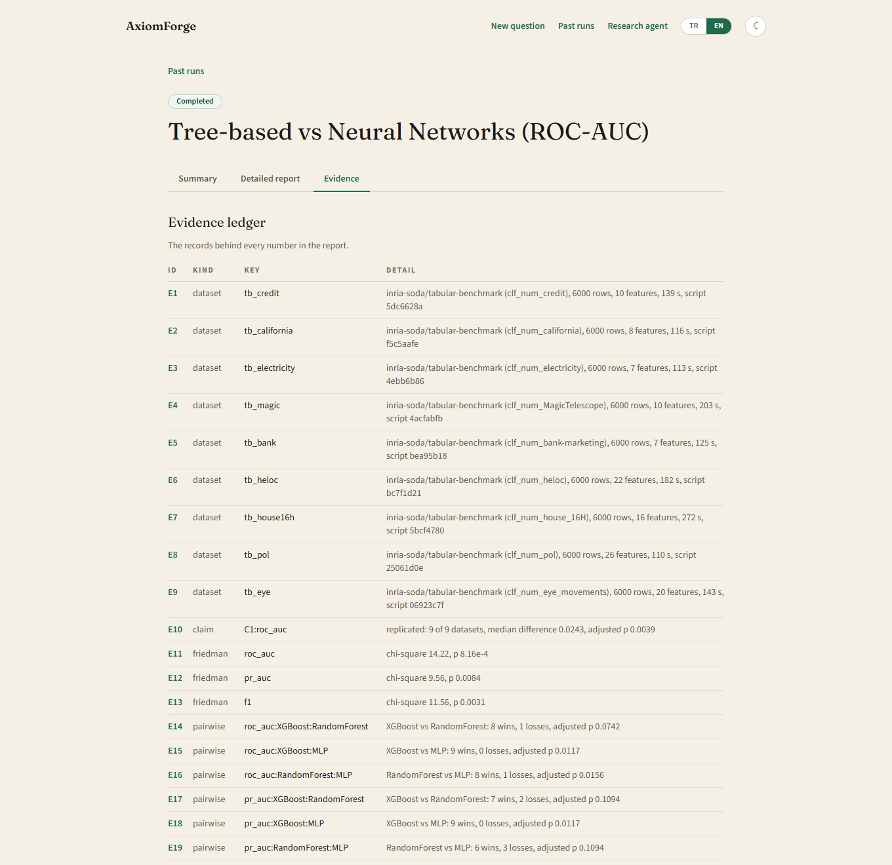</td>
<td width="50%"><b>Research agent session</b><br>16 registered hypotheses, tested once on sealed datasets<br>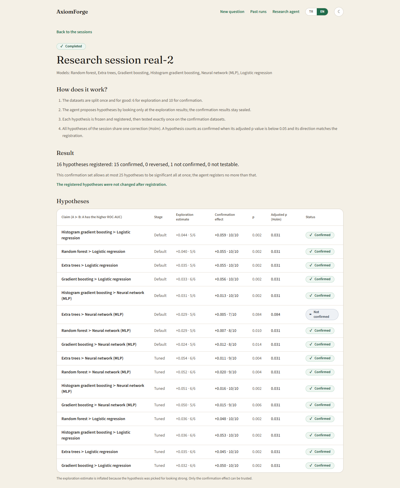</td>
</tr>
<tr>
<td width="50%"><b>Start a session from the console</b><br>Choose models, optional tuned stage, who proposes<br>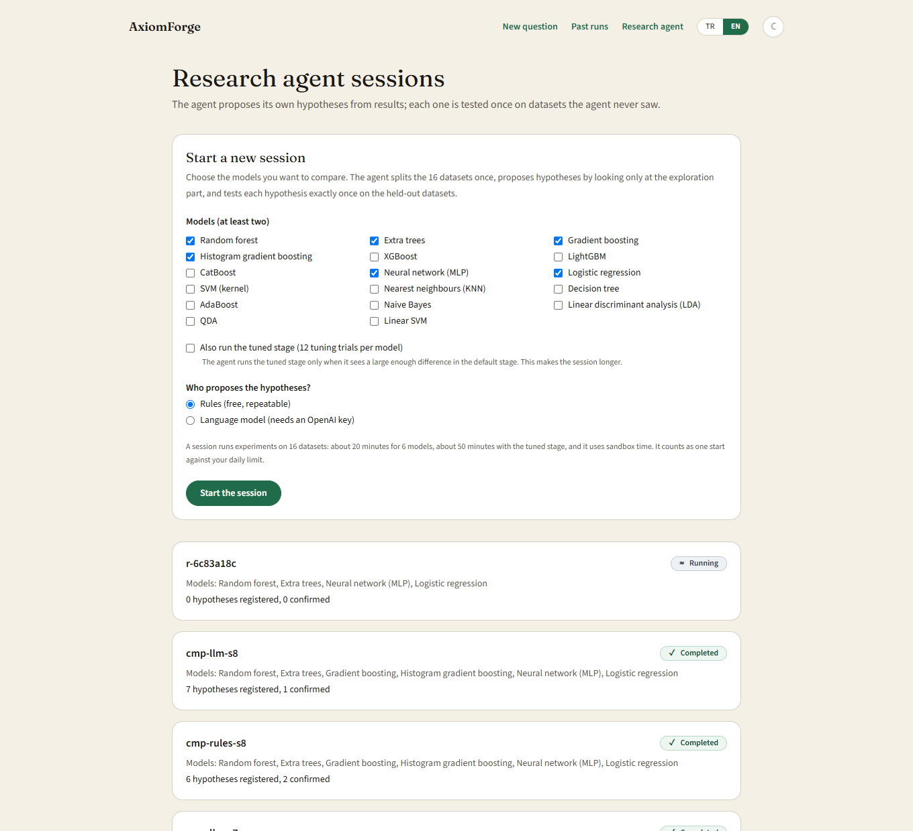</td>
<td width="50%"><b>Live progress of a real run</b><br>Datasets finished and running now<br>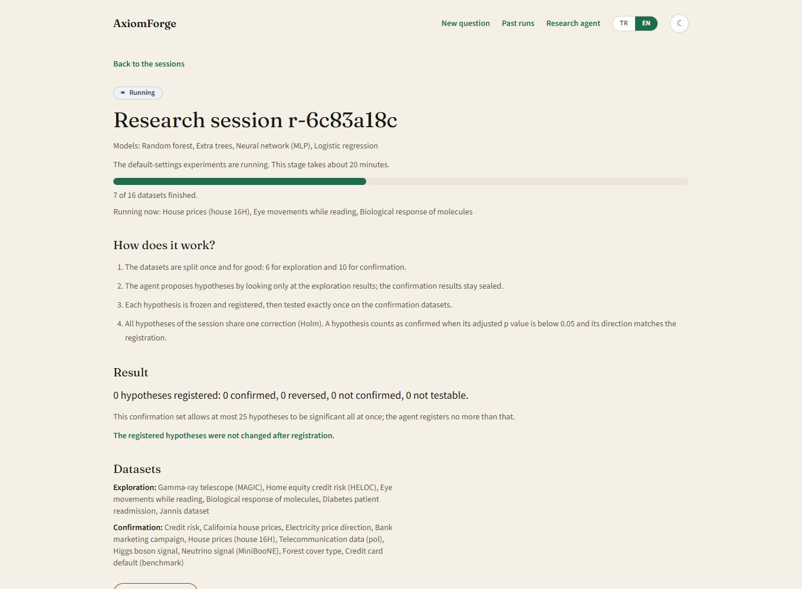</td>
</tr>
</table>

<details>
<summary>More screens</summary>

| Home | Past runs |
| --- | --- |
| 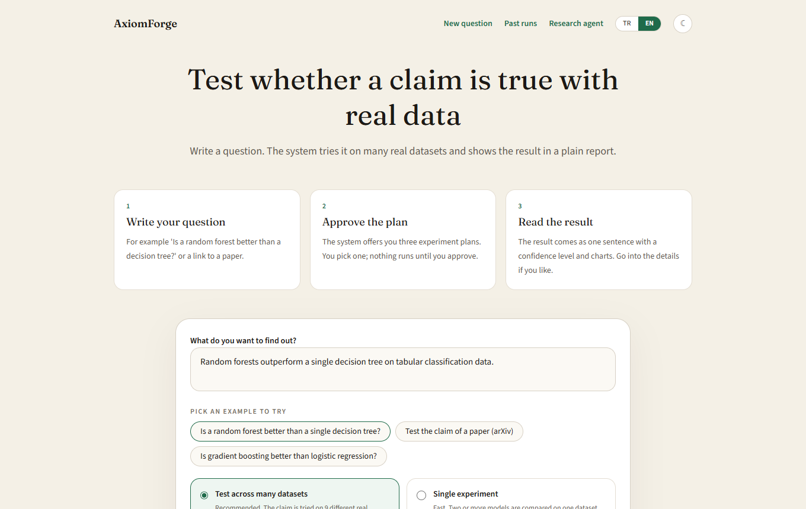 | 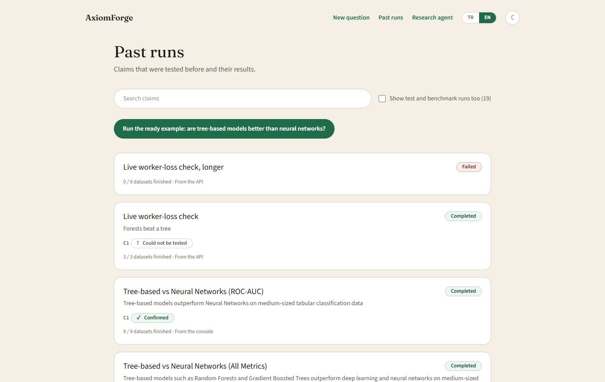 |

| Research session, dark theme |
| --- |
| 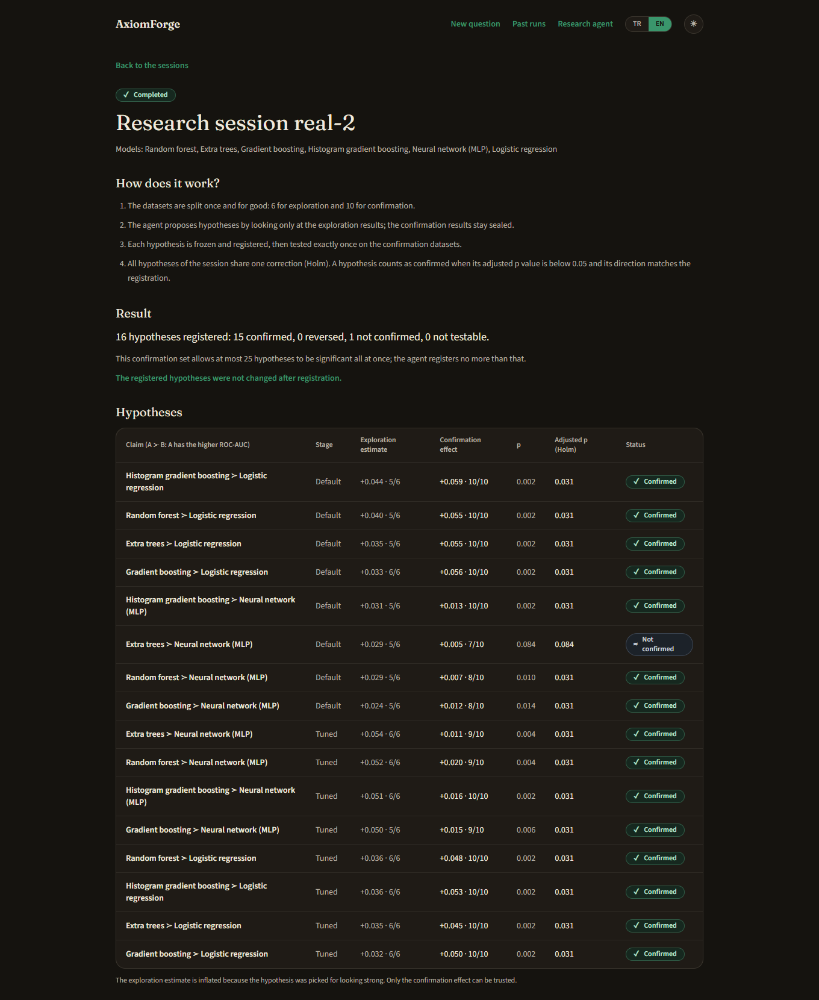 |

</details>

You can explore real results yourself without any API key: see the [demo](demo/README.md).

## How it works

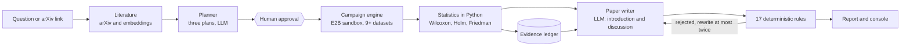

**Who does what**

| The language model | Python (deterministic) |
| --- | --- |
| Reads literature and proposes three experiment plans | Runs the experiments in the sandbox and compares per-dataset scores |
| Writes the introduction and discussion of the paper | Computes every verdict: replicated, partially replicated, contradicted, inconclusive or not testable |
| | Fills the paper's key sentences from the ledger and rejects overclaims with 17 rules |

### The research protocol

A research agent looks at results and then decides what to test next. That is **adaptive analysis**, and it inflates false discoveries. The protocol prevents it:

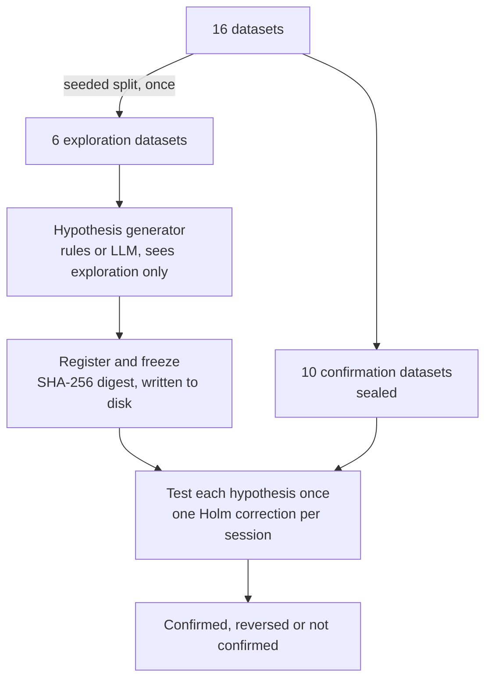

- The generator's function signature has no confirmation argument; it receives a copy of exploration results only.
- Hypotheses are saved **before** any confirmation result is read, and `python -m app.research verify` detects tampering.
- The number of registered hypotheses is capped by arithmetic: with *n* confirmation datasets at most ⌈0.05·2ⁿ⁻¹⌉−1 hypotheses can all be significant (25 for ten).
- Effect sizes are reported from the confirmation datasets; the exploration estimate is inflated by selection and is labelled as such.

### Architecture

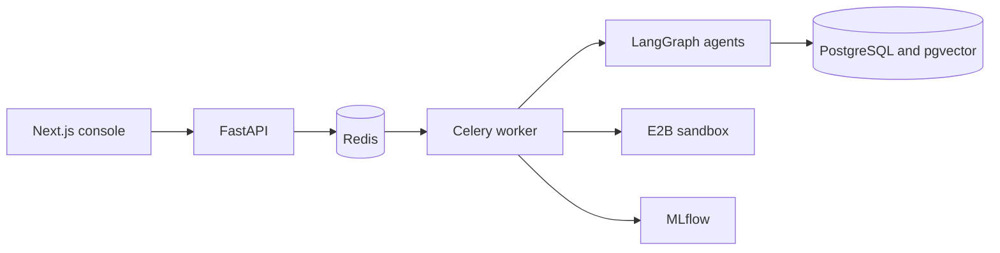

## Concepts in plain words

| Term | Meaning here |
| --- | --- |
| **Replication campaign** | One claim tested on many datasets instead of one experiment |
| **Dataset as the unit** | Scores are averaged over ten splits per dataset, and the *datasets* are what the statistical test compares |
| **Wilcoxon signed-rank test** | A non-parametric test of whether one model beats another across datasets more often than chance allows |
| **Holm correction** | Controls the chance of at least one false positive when many comparisons are made |
| **Friedman test** | Whether a set of models differs at all across datasets |
| **Evidence ledger** | A record per number: dataset revision, row count, library versions, script digest. Reports cite it as `[E1]`, `[E2]`... |
| **Exploration / confirmation datasets** | Data the agent may look at / data it may only be tested on, once |
| **Registered hypothesis** | A hypothesis frozen and saved with a digest before it is tested |
| **Winner's curse** | The best-looking effect in the exploration data is overestimated because it was selected for looking best |
| **Family-wise error** | The probability of at least one false discovery in a set of tests |
| **Mutation testing** | Changing the code on purpose to check that a test fails |

## Tech stack

| Layer | Technology |
| --- | --- |
| Agents and orchestration | LangGraph (human-in-the-loop interrupts, PostgreSQL checkpoints), OpenAI gpt-4o, `text-embedding-3-small` |
| Execution | E2B Code Interpreter sandbox, scikit-learn, XGBoost, LightGBM, CatBoost |
| Statistics | NumPy, SciPy (Wilcoxon, Friedman, Pitman-Morgan, corrected t-tests), Holm and Benjamini-Hochberg |
| Backend | FastAPI, Celery with Redis, pydantic |
| Memory | PostgreSQL with pgvector (experiment memory), MLflow (tracking) |
| Console | Next.js 16, React 19, Tailwind CSS 4; Turkish and English, light and dark; keyboard and screen reader support |
| Quality | pytest, mutation checks, Node test runner, Playwright with axe accessibility scans, GitHub Actions CI |
| Delivery | Docker and Docker Compose (API, worker, MLflow, console, Redis, PostgreSQL) |

## Quick start

### 1. Explore real results, no keys needed

```bash
python -m venv .venv && .venv/bin/pip install -r requirements.txt     # Windows: .venv\Scripts\pip
bash demo/load.sh                                                     # Windows: powershell -File demo/load.ps1
.venv/bin/uvicorn app.main:app --port 8000
cd frontend && npm install && npm run dev
```

Open <http://localhost:3000> (use `localhost`, not `127.0.0.1`). Details in [`demo/README.md`](demo/README.md).

### 2. The full system with Docker

You need an OpenAI key and an E2B key. Real runs cost money: a research session with 6 models takes about 20 minutes of sandbox time (about 50 with the tuned stage).

```bash
cp .env.example .env            # add OPENAI_API_KEY and E2B_API_KEY
docker compose up -d --build
```

| Service | Address |
| --- | --- |
| Console | <http://localhost:3000> |
| API and OpenAPI docs | <http://localhost:8000/docs> |
| MLflow | <http://localhost:5000> |

### 3. Command line

```bash
python -m app.campaign demos                                    # ready campaigns
python -m app.campaign run --demo grinsztajn-2022 --id my-run   # replicate a published claim
python -m app.campaign show my-run                              # the report with its evidence ledger

python -m app.research run --models RandomForest,ExtraTrees,MLP,LogisticRegression --id demo
python -m app.research show demo                                # hypotheses, confirmation results, limits
python -m app.research verify demo                              # were the registered hypotheses changed?
```

### Configuration

Copy [`.env.example`](.env.example) to `.env`. Docker Compose overrides the database, Redis and MLflow addresses for its containers.

| Variable | Purpose |
| --- | --- |
| `OPENAI_API_KEY` | Planner, writer and embeddings. Without it the graph cannot run |
| `E2B_API_KEY` | Sandbox for experiments. Without it no sandbox opens |
| `DATABASE_URL` | PostgreSQL with pgvector (graph checkpoints and experiment memory) |
| `REDIS_URL`, `MLFLOW_TRACKING_URI` | Queue and tracking addresses (defaults for local development) |
| `API_KEY` | If set, endpoints that start paid work require an `X-API-Key` header. Build the console with the same value in `NEXT_PUBLIC_API_KEY` |
| `DAILY_START_LIMIT` | Starts allowed per day (default 100, `0` means unlimited) |
| `CELERY_VISIBILITY_TIMEOUT` | Seconds before a campaign message is redelivered after a worker dies (default 7200) |

### Local development

```bash
docker compose up -d redis postgres
celery -A app.celery_app worker --pool=threads --concurrency=4     # threads pool also works on Windows
uvicorn app.main:app --port 8000
cd frontend && npm run dev
```

### Tests

```bash
python -m pip install -r requirements-dev.txt
python -m pytest -q                       # backend: no LLM, sandbox, database or queue is called
cd frontend
npm test                                  # unit and component tests
npm run build && npm run e2e              # browser tests, with accessibility scans in both themes
```

## What is in the repository

```text
app/
  agents/        literature, planner, experiment, report, consistency checks
  graph/         LangGraph workflow, verifier, statistics, errors
  campaign/      replication engine: spec, protocol, runner, stats, ledger, report, tuning
  research/      research agent: protocol, generators, sessions, service
  sandbox/       E2B runner          memory/   pgvector experiment memory
  datasets.py    real dataset registry (16 numeric datasets for the research pool)
frontend/        Next.js console, unit tests and Playwright specs
tools/           measurements: null calibration, planted effects, language-model baseline, gate benchmarks
tests/           backend tests
demo/            real results to explore without keys
docs/            API reference, development history, screenshots, video, developer notes
```

## Limits

- Binary classification on tabular data from one benchmark family; 16 datasets at most. Nothing is claimed about regression, multi-class, text or images.
- The decision layer has low power for differences under one ROC-AUC point with nine datasets.
- The research agent's hypotheses are model comparisons and tuning effects. One real session was run, and the generator comparison reuses its experiments.
- Paper text is written by one language model (gpt-4o); the deterministic rules are tuned to its habits, and only 3 of the 17 rules fired in the audited drafts.
- No external users or reviewers yet. The research agent is an *exploratory analysis agent with statistical safeguards*, not a discovery engine; the finding it reproduces (tree-based models lead neural networks on medium-sized tabular data) is from Grinsztajn et al., 2022.

## Documentation

| Document | What it covers |
| --- | --- |
| [`TECHNICAL_REPORT.md`](TECHNICAL_REPORT.md) | Problem, method, measurements and limits (English) |
| [`RESEARCH_AGENT.md`](RESEARCH_AGENT.md) | Design of the research agent protocol (Turkish) |
| [`GRAPH.md`](GRAPH.md) | The agent graph, node by node (Turkish) |
| [`docs/API.md`](docs/API.md) · [`docs/API.tr.md`](docs/API.tr.md) | API reference |
| [`docs/HISTORY.md`](docs/HISTORY.md) · [`docs/HISTORY.tr.md`](docs/HISTORY.tr.md) | How the project was built, phase by phase, and what real runs taught |
| [`demo/`](demo/README.md) | Real results to explore without keys |
| [`ROADMAP.md`](ROADMAP.md) | State, known limits and possible next work |
| [`docs/dev-notes/`](docs/dev-notes/) | Developer handover notes and the session log |

## License and author

[MIT](LICENSE) © 2026 Bartu Önder.
