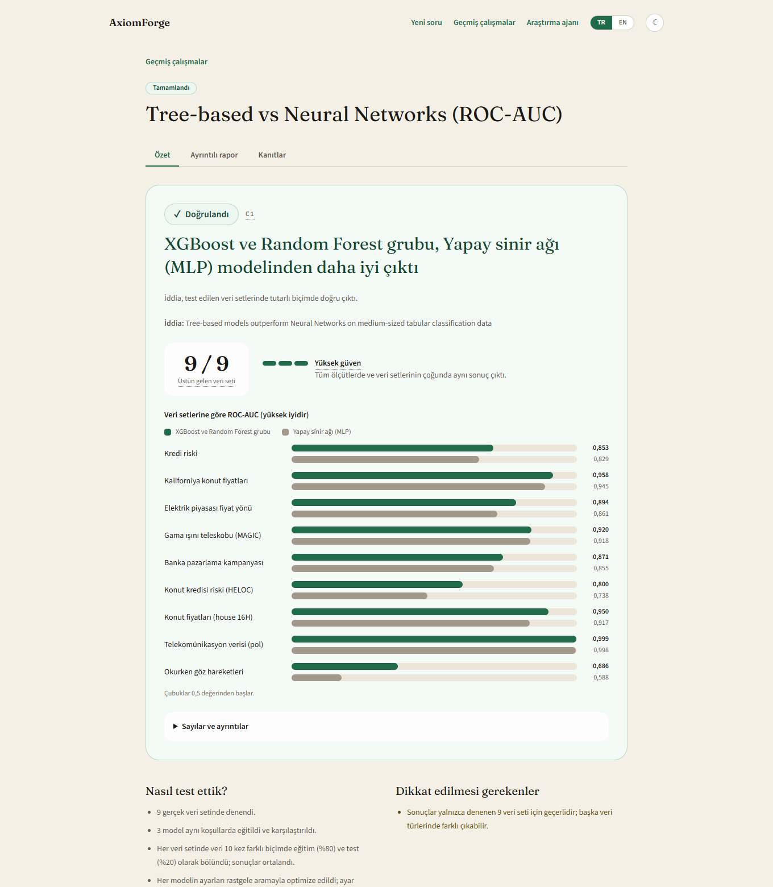
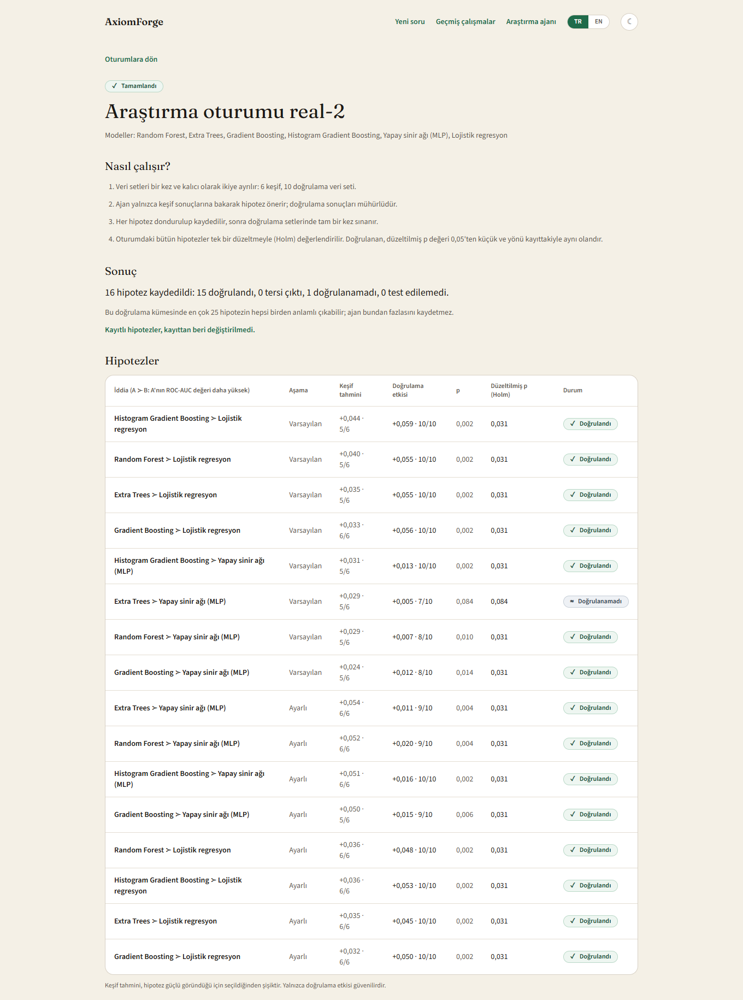
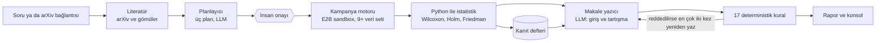
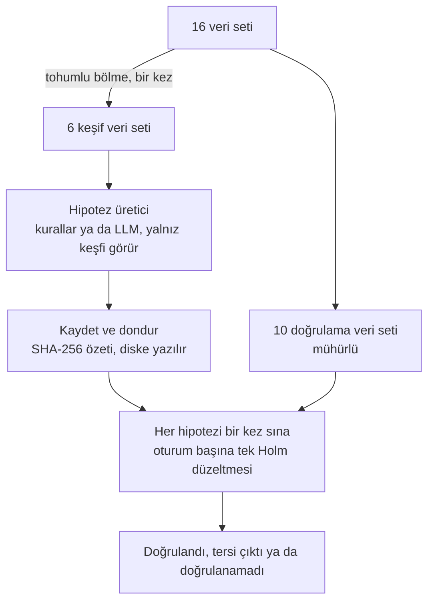
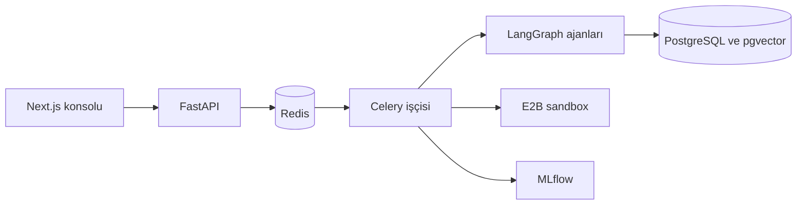

<div align="center">

# AxiomForge

**Makine öğrenmesi iddialarını dil modeliyle değil, istatistikle yeniden üretin.**

Bir iddiayı okuyan, birçok gerçek veri setinde sandbox'ta sınayan ve kararı dil modeline değil Python'a bırakan bir LLM ajan sistemi. Araştırma ajanı kendi takip hipotezlerini önerir ve bunları hiç görmediği veri setlerinde sınar.

[](https://github.com/bartuonder/AxiomForge/actions/workflows/ci.yml)
[](LICENSE)


[English](README.md) · **Türkçe** · [Teknik rapor (İngilizce)](TECHNICAL_REPORT.md) · [Demo](demo/README.tr.md) · [API](docs/API.tr.md)

<a href="docs/media/axiomforge-demo.mp4"></a>

<sub>Gerçek konsoldan kaydedilmiş, sessiz 70 saniyelik gezinti. MP4 için tıklayın.</sub>

</div>

---

## Neden var?

Dil modeli ajanları bir makaleyi okuyabilir, kod yazabilir ve sonucu yazıya dökebilir, ama kanıtın güvenilir hakemi değildir. Yayımlanmış bir makine öğrenmesi iddiasının doğru olup olmadığı sorulduğunda üç şey ters gider:

1. **Akıcı ama dayanaksız sonuçlar.** "A modeli B'den açıkça iyi", ama okuyucunun kontrol edebileceği bir sayı yok.
2. **Hata oranı bilgisi yok.** Gerçek fark yokken sistemin ne sıklıkla "evet" dediğini kimse bilmiyor.
3. **Uyarlamalı analiz.** Sonuçlara bakıp sonra neyi sınayacağını seçen ajan, aynı veriyle seçilmiş hipotezleri sınar ve sahte keşifleri şişirir.

AxiomForge ilk ikisine **kararı yazılmayan, hesaplanan bir replikasyon motoruyla**, üçüncüsüne ise doğrulama verisini hipotezi öneren ajandan **mühürlü tutan bir araştırma protokolüyle** cevap verir.

Dil modeli deneyleri planlar ve düz yazı yazar; asla karar vermez. Kararı Python verir ve raporun her sayısı bir kanıt defteri kaydına bağlıdır.

## Bir bakışta sonuçlar

Tüm sayılar bu depodaki araçlarla üretilir ve yeniden üretilebilir (bkz. [teknik rapor](TECHNICAL_REPORT.md)).

| Soru | Sonuç |
| --- | --- |
| Bilinen iddialarda doğru karar veriyor mu? | 9 gerçek veri setinde bilinen 10 karşılaştırmanın **10'u** beklenen kararı aldı |
| Olmayan farkı uyduruyor mu? | Gerçek etkinin olmadığı simülasyonlarda karar oranı **%2,1**; her gerçek modelin yalnız rastgele tohumu farklı bir kopyasıyla karşılaştırılmasında testlenebilir **45 etkinin 0'ı** anlamlı |
| Araştırma ajanı keşifleri şişiriyor mu? | Aile hatası **%3**; aynı veride seçip test eden ajanda **%24**, düzeltmesiz testte %89 (16 model, gerçek etkisi bilinen simülasyon) |
| Tek başına bir dil modeliyle karşılaştırma | gpt-4o, aynı iddialar veri olmadan sorulunca: 30 cevabın 21'i doğru, 0 yanlış, 9 çekimser. Sistem 10'unu da veriden karara bağlar ve kanıtı da verir |
| Gerçek bir araştırma oturumu | 6 model, 16 veri seti: **16 hipotez kaydedildi, 15 doğrulandı, 0 tersi çıktı, 1 doğrulanamadı**. Ağaç topluluklarının sinir ağına üstünlüğü keşif veri setlerinde yaklaşık 3 kat şişik çıktı (kazananın laneti); rapor yalnız doğrulama veri setlerinden hesaplanan etkiyi gerçek sayar |

Dürüst kısım: karar katmanı tutucudur ve dokuz veri setiyle bir ROC-AUC puanının altındaki farklarda gücü düşüktür; gerçek oturum bilinen bir bulguyu (Grinsztajn ve ark., NeurIPS 2022) yeniden üretti, yeni bir bilimsel sonuç değildir. Bkz. [Sınırlar](#sınırlar).

## Görün

<table>
<tr>
<td width="50%"><b>Sade dilli özet</b><br>Karar, güven, veri seti başına grafik<br></td>
<td width="50%"><b>Aynı sayfa, koyu tema</b><br>Açık ve koyu tema, Türkçe ve İngilizce<br></td>
</tr>
<tr>
<td width="50%"><b>Kanıt defteri</b><br>Veri seti revision'ları, skorlar, testler: her sayı buraya bağlanır<br></td>
<td width="50%"><b>Araştırma ajanı oturumu</b><br>16 kayıtlı hipotez, mühürlü veri setlerinde birer kez sınandı<br></td>
</tr>
<tr>
<td width="50%"><b>Konsoldan oturum başlatma</b><br>Model seçimi, isteğe bağlı ayarlı aşama, öneriyi kim yapsın<br></td>
<td width="50%"><b>Gerçek bir koşunun canlı ilerlemesi</b><br>Biten ve şu an çalışan veri setleri<br></td>
</tr>
</table>

<details>
<summary>Daha fazla ekran</summary>

| Ana sayfa | Geçmiş çalışmalar |
| --- | --- |
|  |  |

| Koyu temada araştırma oturumu |
| --- |
|  |

</details>

Bazı ekran görüntüleri konsolun İngilizce arayüzündedir; konsol Türkçe ve İngilizce çalışır. Gerçek sonuçları hiçbir API anahtarı olmadan kendiniz gezebilirsiniz: bkz. [demo](demo/README.tr.md).

## Nasıl çalışır?



**Kim ne yapar?**

| Dil modeli | Python (deterministik) |
| --- | --- |
| Literatürü okur, üç deney planı önerir | Deneyleri sandbox'ta koşturur ve veri seti başına skorları karşılaştırır |
| Makalenin giriş ve tartışma bölümlerini yazar | Her kararı hesaplar: doğrulandı, kısmen doğrulandı, çürütüldü, kanıt yetersiz, test edilemedi |
| | Makalenin kilit cümlelerini defterden doldurur ve abartıları 17 kuralla reddeder |

### Araştırma protokolü

Sonuçlara bakıp sonra neyi sınayacağına karar veren bir araştırma ajanı **uyarlamalı analiz** yapar ve sahte keşifleri şişirir. Protokol bunu engeller:



- Üretici fonksiyonun imzasında doğrulama argümanı yoktur; yalnız keşif sonuçlarının bir kopyasını alır.
- Hipotezler doğrulama sonucu okunmadan **önce** diske yazılır; `python -m app.research verify` değişiklik olup olmadığını denetler.
- Kayıt sayısı aritmetikle sınırlıdır: *n* doğrulama veri setinde en çok ⌈0,05·2ⁿ⁻¹⌉−1 hipotez birden anlamlı çıkabilir (on veri setinde 25).
- Etki büyüklükleri doğrulama veri setlerinden verilir; keşif tahmini seçilim yüzünden şiştiği için öyle etiketlenir.

### Mimari



## Kavramlar sade dille

| Terim | Burada anlamı |
| --- | --- |
| **Replikasyon kampanyası** | Tek deney yerine bir iddianın birçok veri setinde sınanması |
| **Birim olarak veri seti** | Her veri setinde skorlar on bölmenin ortalamasıdır ve istatistiksel test *veri setlerini* karşılaştırır |
| **Wilcoxon işaretli sıra testi** | Bir modelin ötekini veri setleri arasında şansın izin verdiğinden sık yenip yenmediğini sınayan parametrik olmayan test |
| **Holm düzeltmesi** | Çok karşılaştırma yapılınca en az bir yanlış pozitif olasılığını denetler |
| **Friedman testi** | Bir model kümesinin veri setleri arasında hiç farklı olup olmadığını sınar |
| **Kanıt defteri** | Her sayı için kayıt: veri seti revision'ı, satır sayısı, kütüphane sürümleri, betik özeti. Raporlar `[E1]`, `[E2]` diye atıf yapar |
| **Keşif / doğrulama veri setleri** | Ajanın bakabildiği veri / yalnız bir kez sınanabildiği veri |
| **Kayıtlı hipotez** | Sınanmadan önce dondurulup özetiyle kaydedilen hipotez |
| **Kazananın laneti** | Keşif verisinde en iyi görünen etki, en iyi göründüğü için seçildiğinden olduğundan büyük tahmin edilir |
| **Aile hatası** | Bir test kümesinde en az bir sahte keşif olasılığı |
| **Mutasyon testi** | Bir testin gerçekten başarısız olduğunu görmek için kodu bilerek bozmak |

## Teknoloji yığını

| Katman | Teknoloji |
| --- | --- |
| Ajanlar ve orkestrasyon | LangGraph (insan onayı için kesintiler, PostgreSQL kontrol noktaları), OpenAI gpt-4o, `text-embedding-3-small` |
| Çalıştırma | E2B Code Interpreter sandbox, scikit-learn, XGBoost, LightGBM, CatBoost |
| İstatistik | NumPy, SciPy (Wilcoxon, Friedman, Pitman-Morgan, düzeltilmiş t-testleri), Holm ve Benjamini-Hochberg |
| Arka uç | FastAPI, Redis'li Celery, pydantic |
| Hafıza | pgvector'lı PostgreSQL (deney hafızası), MLflow (izleme) |
| Konsol | Next.js 16, React 19, Tailwind CSS 4; Türkçe ve İngilizce, açık ve koyu tema; klavye ve ekran okuyucu desteği |
| Kalite | pytest, mutasyon denetimi, Node test koşucusu, axe erişilebilirlik taramalı Playwright, GitHub Actions CI |
| Dağıtım | Docker ve Docker Compose (API, işçi, MLflow, konsol, Redis, PostgreSQL) |

## Hızlı başlangıç

### 1. Anahtarsız gerçek sonuçları gezin

```bash
python -m venv .venv && .venv/bin/pip install -r requirements.txt     # Windows: .venv\Scripts\pip
bash demo/load.sh                                                     # Windows: powershell -File demo/load.ps1
.venv/bin/uvicorn app.main:app --port 8000
cd frontend && npm install && npm run dev
```

<http://localhost:3000> adresini açın (`127.0.0.1` değil, `localhost`). Ayrıntı: [`demo/README.tr.md`](demo/README.tr.md).

### 2. Docker ile tüm sistem

Bir OpenAI anahtarı ve bir E2B anahtarı gerekir. Gerçek koşular para harcar: 6 modelli bir araştırma oturumu yaklaşık 20 dakika sandbox süresi tutar (ayarlı aşamayla yaklaşık 50 dakika).

```bash
cp .env.example .env            # OPENAI_API_KEY ve E2B_API_KEY değerlerini yazın
docker compose up -d --build
```

| Servis | Adres |
| --- | --- |
| Konsol | <http://localhost:3000> |
| API ve OpenAPI belgesi | <http://localhost:8000/docs> |
| MLflow | <http://localhost:5000> |

### 3. Komut satırı

```bash
python -m app.campaign demos                                    # hazır kampanyalar
python -m app.campaign run --demo grinsztajn-2022 --id my-run   # yayımlanmış bir iddiayı yeniden üret
python -m app.campaign show my-run                              # kanıt defterli rapor

python -m app.research run --models RandomForest,ExtraTrees,MLP,LogisticRegression --id demo
python -m app.research show demo                                # hipotezler, doğrulama sonuçları, sınırlar
python -m app.research verify demo                              # kayıtlı hipotezler değişti mi?
```

### Yapılandırma

[`.env.example`](.env.example) dosyasını `.env` olarak kopyalayın. Docker Compose, konteynerler için veritabanı, Redis ve MLflow adreslerini kendisi verir.

| Değişken | Amaç |
| --- | --- |
| `OPENAI_API_KEY` | Planlayıcı, yazıcı ve gömüler. Yoksa graf çalışmaz |
| `E2B_API_KEY` | Deneyler için sandbox. Yoksa sandbox açılmaz |
| `DATABASE_URL` | pgvector'lı PostgreSQL (graf kontrol noktaları ve deney hafızası) |
| `REDIS_URL`, `MLFLOW_TRACKING_URI` | Kuyruk ve izleme adresleri (yerel geliştirme varsayılanları) |
| `API_KEY` | Tanımlıysa ücretli iş başlatan uçlar `X-API-Key` başlığı ister. Konsolu aynı değerle `NEXT_PUBLIC_API_KEY` vererek derleyin |
| `DAILY_START_LIMIT` | Günlük izin verilen başlatma sayısı (varsayılan 100, `0` sınırsız) |
| `CELERY_VISIBILITY_TIMEOUT` | İşçi ölünce bir kampanya iletisinin yeniden teslim edilmeden önce bekleme süresi, saniye (varsayılan 7200) |

### Yerel geliştirme

```bash
docker compose up -d redis postgres
celery -A app.celery_app worker --pool=threads --concurrency=4     # threads havuzu Windows'ta da çalışır
uvicorn app.main:app --port 8000
cd frontend && npm run dev
```

### Testler

```bash
python -m pip install -r requirements-dev.txt
python -m pytest -q                       # arka uç: LLM, sandbox, veritabanı ya da kuyruk çağrılmaz
cd frontend
npm test                                  # birim ve bileşen testleri
npm run build && npm run e2e              # tarayıcı testleri, iki temada erişilebilirlik taramasıyla
```

## Depoda ne var?

```text
app/
  agents/        literatür, planlayıcı, deney, rapor, tutarlılık kontrolleri
  graph/         LangGraph iş akışı, doğrulayıcı, istatistik, hatalar
  campaign/      replikasyon motoru: belirtim, protokol, koşucu, istatistik, defter, rapor, ayar
  research/      araştırma ajanı: protokol, üreticiler, oturumlar, servis
  sandbox/       E2B koşucusu        memory/   pgvector deney hafızası
  datasets.py    gerçek veri seti kaydı (araştırma havuzu için 16 sayısal veri seti)
frontend/        Next.js konsolu, birim testleri ve Playwright senaryoları
tools/           ölçümler: boş karşılaştırma, yerleştirilmiş etkiler, dil modeli kıyası, kapı ölçümleri
tests/           arka uç testleri
demo/            anahtarsız gezilebilen gerçek sonuçlar
docs/            API başvurusu, geliştirme tarihçesi, ekran görüntüleri, video, geliştirici notları
```

## Sınırlar

- Tek bir benchmark ailesinden tablo verisi üzerinde ikili sınıflandırma; en çok 16 veri seti. Regresyon, çok sınıf, metin ya da görüntü hakkında hiçbir iddia yoktur.
- Karar katmanının, dokuz veri setiyle, bir ROC-AUC puanının altındaki farklarda gücü düşüktür.
- Araştırma ajanının hipotezleri model karşılaştırmaları ve ayar etkileridir. Tek gerçek oturum koşuldu; üretici karşılaştırması onun deneylerini yeniden kullanır.
- Makale metnini tek bir dil modeli (gpt-4o) yazar; deterministik kurallar onun alışkanlıklarına göre ayarlıdır ve denetlenen taslaklarda 17 kuraldan yalnız 3'ü ateşledi.
- Henüz dış kullanıcı ya da hakem yok. Araştırma ajanı bir keşif motoru değil, *istatistiksel güvenceli bir keşifsel analiz ajanıdır*; yeniden ürettiği bulgu (orta boy tablo verisinde ağaç tabanlı modeller sinir ağlarından iyidir) Grinsztajn ve ark., 2022'ye aittir.

## Belgeler

| Belge | Ne anlatır |
| --- | --- |
| [`TECHNICAL_REPORT.md`](TECHNICAL_REPORT.md) | Sorun, yöntem, ölçümler ve sınırlar (İngilizce) |
| [`RESEARCH_AGENT.md`](RESEARCH_AGENT.md) | Araştırma ajanı protokolünün tasarımı |
| [`GRAPH.md`](GRAPH.md) | Ajan grafı, düğüm düğüm |
| [`docs/API.tr.md`](docs/API.tr.md) · [`docs/API.md`](docs/API.md) | API başvurusu |
| [`docs/HISTORY.tr.md`](docs/HISTORY.tr.md) · [`docs/HISTORY.md`](docs/HISTORY.md) | Proje faz faz nasıl kuruldu, gerçek koşular ne öğretti |
| [`demo/`](demo/README.tr.md) | Anahtarsız gezilebilen gerçek sonuçlar |
| [`ROADMAP.md`](ROADMAP.md) | Durum, bilinen sınırlar ve olası sonraki işler |
| [`docs/dev-notes/`](docs/dev-notes/) | Geliştirici devir notları ve oturum kaydı |

## Lisans ve yazar

[MIT](LICENSE) © 2026 Bartu Önder.
